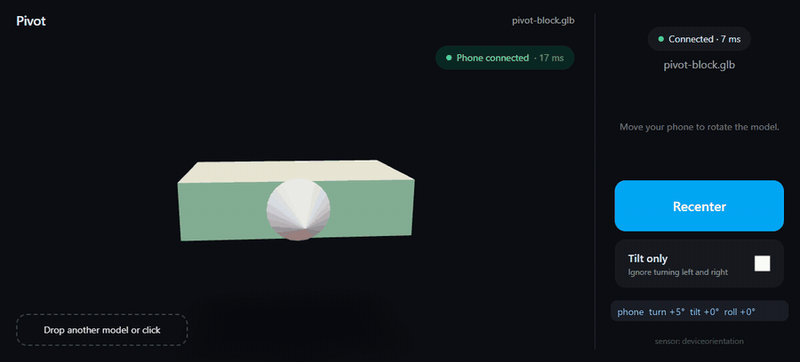

# Pivot

Upload a 3D model on your laptop, scan a QR code with your phone, and rotate the model by moving
the phone. No app to install: the phone opens a web page, reads its orientation sensors and
streams them to the laptop in real time.



<sub>The demo was recorded with simulated phone orientation (the same synthetic sensor events the
end-to-end test uses).</sub>

## Quick start

You only need [Docker](https://docs.docker.com/get-docker/) (with Compose v2).

```sh
git clone https://github.com/rimmelasghar/Pivot.git
cd Pivot
docker compose up --build
```

1. Open **http://localhost:8080** on the laptop.
2. Drop a `.glb` or `.gltf` file (max 50 MB) on the page, or click **try the sample model**.
3. Wait for the QR code ("Preparing secure link…" takes about 10 s on the first start).
4. Scan the QR code with your phone and tap **Tap to connect**. On iPhone, allow motion access.
5. Move the phone. The model follows it.

On the phone:

- **Recenter** makes the current pose the neutral pose.
- **Tilt only** ignores turning left and right. Use it if the model slowly drifts on its own
  (a poor compass, or metal nearby).

The phone does not need to be on the same Wi-Fi: it reaches the laptop through a temporary
Cloudflare quick tunnel (HTTPS, which phones require before they expose motion sensors).
Latency is lowest when both devices are on the same network.

## How it works

```
phone ──HTTPS/WSS──▶ cloudflared tunnel ─┐
                                         ├─▶ Caddy proxy :8080 ─┬─▶ web  (Next.js: viewer + controller)
laptop ──http://localhost:8080 ──────────┘                      └─▶ api  (FastAPI: REST + WebSocket hub)
                                                                         │
                                                                       Redis (sessions with TTL + pub/sub)
```

1. The laptop creates a session (`POST /api/sessions`), uploads the model and connects to
   `/ws/{id}?role=desktop`.
2. The QR code holds `{public tunnel URL}/c/{id}?t={pairToken}`. The phone connects with
   `role=phone`. Only one phone can be paired at a time.
3. The phone sends its orientation as a quaternion up to 60 times per second, only while it moves.
   The api relays it through Redis pub/sub to the laptop.
4. The laptop measures the rotation since the neutral pose, maps it to scene axes and smooths it
   (frame-rate independent slerp).

The message protocol is in [packages/protocol/protocol.md](packages/protocol/protocol.md).

## Configuration

Copy `.env.example` to `.env` to change defaults.

| Variable | Default | Purpose |
| --- | --- | --- |
| `PUBLIC_BASE_URL` | (empty) | Public HTTPS URL for the QR code. When empty, the quick tunnel URL is used. |
| `TUNNEL_TOKEN` | (empty) | Cloudflare named tunnel with a fixed URL (see below). |
| `MAX_UPLOAD_MB` | `50` | Largest model upload. |
| `SESSION_TTL_SECONDS` | `1800` | A session (and its model file) is deleted after this much inactivity. |
| `REDIS_URL` | `redis://redis:6379/0` | Redis connection. |

**Fixed URL (named tunnel).** Quick tunnels get a new random URL on each start and have no
uptime guarantee. For demos, create a tunnel in the Cloudflare dashboard that routes your
hostname to `http://proxy:80`, put `TUNNEL_TOKEN` and `PUBLIC_BASE_URL=https://<hostname>` in
`.env`, and run:

```sh
docker compose -f docker-compose.yml -f infra/docker-compose.named-tunnel.yml up --build
```

## Development

```
apps/web            Next.js 15 app: desktop viewer (/) and phone controller (/c/[sessionId])
apps/api            FastAPI: sessions, uploads, public URL, WebSocket hub
packages/protocol   WebSocket protocol: spec, TypeScript types, validator
infra               Caddyfile, dev and named-tunnel compose overrides
```

Hot reload (source folders are mounted into the containers):

```sh
docker compose -f docker-compose.yml -f infra/docker-compose.dev.yml up --build
```

Checks:

```sh
# Web and protocol (on the host, Node 22+ and pnpm)
pnpm install
pnpm lint && pnpm typecheck && pnpm test

# Same checks in containers
docker compose -f docker-compose.yml -f infra/docker-compose.dev.yml run --rm --no-deps web pnpm test
docker compose -f docker-compose.yml -f infra/docker-compose.dev.yml run --rm --no-deps api pytest

# End-to-end (stack running on localhost:8080)
pnpm --filter @pivot/web exec playwright install chromium
pnpm --filter @pivot/web test:e2e
```

Regenerate the sample model with `python apps/web/scripts/make_sample_glb.py`.

See [AGENTS.md](AGENTS.md) for contribution rules (Conventional Commits, tests in every feature
commit, protocol changes in TypeScript and Pydantic together).

## Troubleshooting

| Problem | What to do |
| --- | --- |
| The QR code stays on "Preparing secure link…" | The tunnel is still starting or cannot reach Cloudflare. Run `docker compose logs tunnel`. Some office networks block it: use a named tunnel or set `PUBLIC_BASE_URL`. |
| The phone shows "Invalid link" or "Session expired" | The QR code is from an old session. Reload the laptop page and scan again. |
| The phone shows "Already paired" | Another phone controls this model. Close the controller page on it, wait a few seconds and scan again. |
| The phone shows "No motion sensor" | The device or browser has no gyroscope or gives no orientation data. Try Chrome on Android or Safari on iPhone. |
| iPhone: "Motion access denied" | Safari > aA menu > Website Settings > Motion & Orientation Access: Allow. Then reload. |
| The model turns the wrong way or slowly drifts | Tap **Recenter** while holding the phone in a comfortable pose. Turn on **Tilt only** if it keeps drifting. |
| Motion stops after switching apps | Come back to the controller page. It resumes and reconnects automatically. You do not need to scan again. |
| Laptop shows "Reconnecting to server…" | The api restarted or the network dropped. The page retries after 1, 2, 4 and then every 8 s. |
| Upload fails with "not a valid glTF" | Only `.glb` and self-contained `.gltf` (embedded buffers) are supported. Convert other formats, e.g. with Blender (File > Export > glTF 2.0). |
| Port 8080 is in use | Change `"8080:80"` under `proxy` in `docker-compose.yml`. |

## Status

The MVP (phases 0–4) is done: upload and viewer, tunnel and pairing, motion sync, robustness
(status and RTT, error screens, background/resume, rate limits) and an end-to-end test.
Next: a WebRTC DataChannel for lower latency, then OBJ/FBX/STL conversion, multiple phones and
an embeddable viewer.

## License

[MIT](LICENSE)
